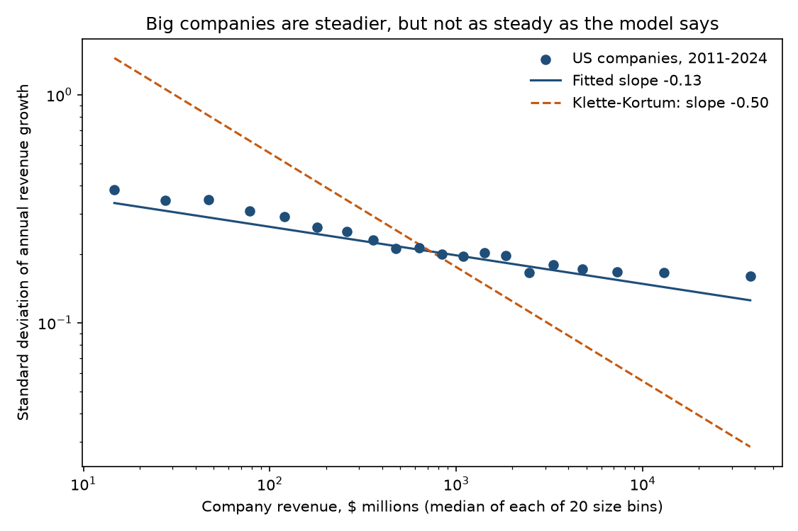
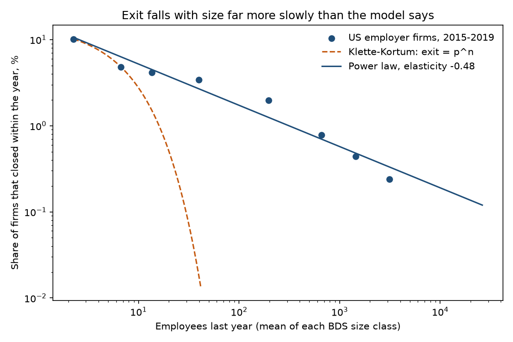
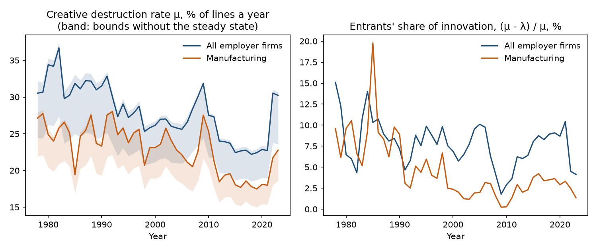

# How Firms Grow and Die

### In 2004 Tor Jakob Klette and Samuel Kortum described a company as a bundle of products, each won by innovation and each lost to a rival's. I tested their model against fourteen years of American company filings and forty-six years of Census records.

---

In 2024 Intel spent $16.5 billion on research and development, 31% of the $53.1 billion it took in. Nvidia spent
less, $12.9 billion in the year to January 2025, and sold $130.5 billion of chips and systems, more than twice
Intel's revenue. Ten years earlier Intel had sold $55.9 billion and Nvidia $4.7 billion, according to the annual
reports both file with the Securities and Exchange Commission. A company's products are not permanent. A rival with a
better design can take a market away, and the money a firm spends on research is what lets it take markets from
others before its own are taken.

Joseph Schumpeter called this creative destruction. Tor Jakob Klette and Samuel Kortum turned it into a model of
the individual firm that explains why firms differ so much in size, why big
ones grow steadily and small ones erratically, and why research spending tracks sales. Twenty years later the model
sits underneath much of the economics of innovation and business dynamism, and its predictions are exact enough to
check.

---

## A firm as a bundle of product lines

In the model a firm is the number of product lines it currently sells, written $`n`$. Each line brings in the same
revenue, so revenue is proportional to $`n`$. The firm adds lines when its research succeeds, at a rate
$`\lambda`$ per line it already owns, and it loses each line when some other firm improves on it, at a rate
$`\mu`$ per line. Economists call $`\mu`$ the intensity of creative destruction. A firm that loses its last line
exits.

Two measures carry the test. The first is research intensity, research spending divided by revenue.

```math
\text{R\&D intensity} = \frac{R}{S},
\qquad
\text{Intel, 2024:}\ \ \frac{\$16.5\ \text{billion}}{\$53.1\ \text{billion}} = 0.312
```

Here $`R`$ is research and development expense and $`S`$ is sales. The model says this ratio does not depend on
how big the firm is. A company twice as large has twice as much accumulated know-how to draw on, and it spends twice
as much to put it to work.

The second measure is how much a company's revenue jumps around from one year to the next. I take annual growth in
log points and its standard deviation across firms of similar size.

```math
g_{i,t+1} = \ln \frac{S_{i,t+1}}{S_{it}},
\qquad
\sigma(S) = \operatorname{sd}\left(g_{i,t+1} \mid S_{it} \approx S\right)
```

For American public companies near the median size, about $729 million of revenue, $`\sigma`$ is 0.205, so a
typical company of that size sees its revenue move about 21% up or down in a year relative to the average company
that year. The model's sharpest prediction is how this number shrinks with size. A firm of $`n`$ lines behaves like
$`n`$ independent one-line firms added together, so its volatility falls with the square root of its size.

```math
\sigma(n) = \frac{\sigma(1)}{\sqrt{n}},
\qquad
\text{Apple, } 537\times \text{the median firm:}\ \ \frac{0.205}{\sqrt{537}} \approx 0.009
```

Apple's revenue is 537 times the median company's, so the model expects it to move by less than 1% in a typical
year. At the extremes the square-root rule looks like this.

| Firm | Product lines | Volatility relative to a one-line firm |
|---|---|---|
| A single-product startup | 1 | 1 |
| A mid-sized manufacturer | 100 | 0.1 |
| A conglomerate | 10,000 | 0.01 |

---

## Klette and Kortum's model

Tor Jakob Klette was a Norwegian economist at the University of Oslo who spent his career with firm-level data,
much of it from Statistics Norway, measuring productivity, market power and the returns to research. Samuel Kortum
was then at the University of Minnesota and the Federal Reserve Bank of Minneapolis, already known for his work with
Jonathan Eaton on technology and trade. He is now the James Burrows Moffatt Professor of Economics at Yale. Their
paper, "Innovating Firms and Aggregate Innovation," appeared in the *Journal of Political Economy* in 2004.
Klette did not see it in print. He died in August 2003, and the paper's acknowledgment note records how hard it had
been to finish the final revisions without him.

The paper opens with ten facts from decades of firm-level research, among them that research intensity does not
depend on firm size, that research budgets follow something close to a random walk, and that small firms die more
often and grow more erratically. Klette and Kortum built a deliberately parsimonious model to account for them
together, and closed it in general equilibrium.

The two results tested here take a few lines. Suppose a firm with $`n`$ lines chooses its innovation rate
$`I`$ to maximize the value of new lines, $`v`$ each, minus a research cost $`n\,c(I/n)`$ that is convex in the
innovation rate per line, and suppose each line is lost to rivals independently at rate $`\mu`$. With revenue per
line normalized to one, $`S = n`$.

```math
\begin{aligned}
c'(I/n) = v \;&\Rightarrow\; I = \lambda n,\quad R = n\,c(\lambda) \\
&\Rightarrow\; \ln R = \ln c(\lambda) + \ln S \\
\mathbb{E}[\Delta N \mid n] &= n(\lambda - \mu)\,dt \\
\operatorname{Var}[\Delta N \mid n] &= n(\lambda + \mu)\,dt \\
\operatorname{Var}\!\left[\tfrac{\Delta N}{n} \,\middle|\, n\right] &= \frac{(\lambda + \mu)\,dt}{n}
\end{aligned}
```

Because the first-order condition does not involve $`n`$, every firm innovates at the same rate per line and spends
the same share of revenue on research, so the elasticity of research with respect to sales is exactly one. Expected
growth, $`\lambda - \mu`$, is the same for every size, which is Gibrat's law. The variance of growth is the
variance of a sum of $`n`$ independent pieces divided by $`n^2`$, so it falls as $`1/n`$ and the standard deviation
as $`1/\sqrt{n}`$. The same independence implies that the chance of exit is $`p^n`$, where $`p`$ is the chance a
one-line firm exits, so exit should fall geometrically with size.

The paper reports no data of its own, so its headline numbers are these exact predictions, an elasticity of one for
research and minus one half for volatility. The authors flagged the trouble with the second one themselves. Footnote 11 notes that
since Stephen Hymer and Peter Pashigian's study in 1962, the variance of firm growth has been known to fall less
steeply than the inverse of size, and footnote 9 concedes that in the data young firms die more often than old
firms of the same size, which the model rules out. The strongest later challenge came from the authors' own
successors. Ufuk Akcigit and William Kerr showed in 2018 that large firms tilt their research toward improving
products they already sell, so research is not one homogeneous activity that scales with size. Akcigit and Sina
Ates later built on the same machinery to argue that slower diffusion of knowledge from leading firms to laggards
explains most of the decline in American business dynamism. The question Klette and Kortum asked, how much of
aggregate innovation is done by incumbents and how much by entrants, is the question behind that debate.

---

## How I tested it

For research and growth I used every company that files a 10-K annual report with the SEC, from the SEC's
Financial Statement Data Sets for fiscal 2011 to 2024. I kept companies with a US business address and at least
$10 million of revenue, and dropped banks, insurers and real estate trusts, whose revenue is not comparable. That
left 41,341 firm-years from 5,546 companies. Research spending is the R&D expense companies tag in their filings,
and as in the studies Klette and Kortum summarized, the research tests use only the 15,707 firm-years with positive
R&D. Growth runs from each of the 41,341 firm-years to the next fiscal year, keeping companies whose revenue then falls
below $10 million, and uses 35,221 pairs after trimming the top and bottom 1% of growth rates, which are mostly
mergers and spin-offs.

The three estimating equations follow.

```math
\begin{aligned}
\ln R_{it} &= \alpha_{s(i)} + \tau_t + \beta \ln S_{it} + \varepsilon_{it}, & H_0:\ \beta = 1 \\
g_{i,t+1} &= \tau_t + \gamma \ln S_{it} + u_{i,t+1}, & H_0:\ \gamma = 0 \\
\ln \lvert \tilde{u}_{i,t+1} \rvert &= a + \delta \ln S_{it} + e_{i,t+1}, & H_0:\ \delta = -\tfrac{1}{2}
\end{aligned}
```

Here $`i`$ is a company, $`t`$ a fiscal year, $`\alpha_{s(i)}`$ a fixed effect for the company's three-digit SIC
industry, $`\tau_t`$ a year effect, and $`\tilde{u}`$ growth minus that year's average. If volatility is
proportional to $`S^{\delta}`$, the log of the absolute deviation has slope $`\delta`$ on log size. Standard
errors are clustered by company. The second equation is estimated separately for the smaller and larger halves
of the sample by revenue, because the model predicts Gibrat's law only for large firms. I also estimate $`\delta`$ from 20 size bins, with a confidence interval from 500
bootstrap draws of whole companies.

Public companies rarely die in the model's sense. They are acquired or go private. For exit I used the Census
Bureau's Business Dynamics Statistics, which count every American employer firm and every firm death, a firm whose
establishments all close, by size the year before and by age. I pooled 2015 to 2019 and compared two laws for the
death rate $`d_k`$ of size class $`k`$ with mean employment $`\bar{e}_k`$, the model's geometric law
$`\ln d_k = a + b\,\bar{e}_k`$ and a power law $`\ln d_k = a + b \ln \bar{e}_k`$.

---

## Among large companies, research rises in step with sales

| Sample | Elasticity of R&D to revenue | 95% interval | Firm-years |
|---|---|---|---|
| Revenue at least $1 million | 0.72 | 0.70 to 0.74 | 18,632 |
| Revenue at least $10 million (main sample) | 0.80 | 0.78 to 0.83 | 15,707 |
| Revenue at least $100 million | 0.87 | 0.83 to 0.90 | 10,480 |
| Revenue at least $1 billion | 0.97 | 0.90 to 1.04 | 4,294 |
| Software and IT services | 0.96 | 0.92 to 1.01 | 3,279 |
| Drugs and chemicals | 0.65 | 0.59 to 0.71 | 3,339 |

In the main sample the estimate is below one by a wide margin.

```math
\hat{\beta} = 0.80\ (0.013),\quad 95\%\ \text{CI}\ [0.78,\ 0.83],\quad N = 15{,}707
```

The shortfall comes from the small end. Among companies with at least $1 billion of revenue the estimate is
indistinguishable from the model's value of one.

```math
\hat{\beta}_{S \ge \$1\text{B}} = 0.97\ (0.037),\quad 95\%\ \text{CI}\ [0.90,\ 1.04],\quad N = 4{,}294
```

Wesley Cohen and Steven Klepper, whom Klette and Kortum quote, had reached the same conclusion for research
performers in the 1990s. What pulls the full-sample estimate down is a population the model leaves out, small
companies with a product or two on the market and a research program aimed at products that do not exist yet.
Drug and biotechnology firms are the clearest case, with an elasticity of 0.65, and in fiscal 2024 the median R&D
reporter with $10 million to $100 million of revenue spent 24% of it on research, against 6.5% for companies with
$10 billion to $100 billion. Within the largest companies the ratio varies more than size can explain. Meta spent
26.7% of revenue on research in 2024, Merck 28.0%, Alphabet 14.1%, Microsoft 11.5% and Apple 8.0%.

Within a company over time the elasticity is 0.56, so research budgets move less than sales do from year to year.
The model's prediction that log research follows a random walk holds almost exactly. Regressing the annual change
in log R&D on its level gives a slope of −0.0009 with a standard error of 0.0014.

---

## Big companies are steadier than small ones, but nowhere near as steady as the model says

The smallest twentieth of companies, with a median of $15 million in revenue, have a growth volatility of 0.384. The
largest twentieth, with a median of $37.7 billion, have 0.161. Size cuts volatility by a little more than half across
a more than 2,500-fold range of revenue, where the square-root rule would cut it by a factor of about 50.

```math
\hat{\delta} = -0.15\ (0.005),\quad 95\%\ \text{CI}\ [-0.16,\ -0.14],\quad N = 35{,}221
```

The binned estimate is −0.13, with a bootstrap interval of −0.13 to −0.12. A version that ignores the tails of
each bin gives −0.17, and the firm-level regression without trimming gives −0.18. All four are far from −0.5.



For each company below, the model's figure scales the median firm's volatility by the square root of relative
size, and the actual figure is the standard deviation of the company's own annual revenue growth, 2011 to 2024.

| Company | Revenue, 2024 | Times the median firm | Volatility, model | Volatility, actual |
|---|---|---|---|---|
| Walmart | $681 billion | 934 | 0.007 | 0.023 |
| Apple | $391 billion | 537 | 0.009 | 0.131 |
| Microsoft | $282 billion | 387 | 0.010 | 0.075 |
| Meta Platforms | $165 billion | 226 | 0.014 | 0.135 |
| Nvidia | $130 billion | 179 | 0.015 | 0.289 |
| Tesla | $98 billion | 134 | 0.018 | 0.216 |
| Merck | $64 billion | 88 | 0.022 | 0.072 |
| Pfizer | $64 billion | 87 | 0.022 | 0.274 |
| iRobot | $0.68 billion | 0.9 | 0.212 | 0.192 |

Walmart, a retailer whose thousands of stores really do behave something like independent units, comes closest,
and even it moves more than three times as much as the rule allows. The standard deviation of Nvidia's annual
revenue growth was 0.29 as demand for its data-center chips rose and fell, and Pfizer's was 0.27 as its vaccine
sales arrived and vanished.
Large companies are not portfolios of independent bets. Their products share customers, technologies and often a
single blockbuster.

On average growth itself is close to independent of size among larger firms, as Gibrat's law requires. In the
larger half of the sample each log point of revenue lowers expected growth by 0.93 percentage points, so a company
ten times bigger grows about 2.1 points a year slower, a small but statistically clear departure. The model also
says that among survivors the smallest firms should grow fastest. In the smaller half the slope is +0.36 points with
a standard error of 0.22, so the data show no such effect.

---

## Exit falls with size as a power, not geometrically, and age matters on its own

| Employees last year | Firms at risk, yearly average | Share that closed | Model, calibrated on the two smallest classes |
|---|---|---|---|
| 1 to 4 | 2,924,069 | 10.2% | 10.2% |
| 5 to 9 | 1,007,051 | 4.8% | 4.8% |
| 10 to 19 | 625,616 | 4.2% | 1.5% |
| 20 to 99 | 533,503 | 3.4% | 0.02% |
| 100 to 499 | 91,320 | 2.0% | essentially zero |
| 500 to 999 | 10,334 | 0.78% | essentially zero |
| 1,000 to 2,499 | 5,963 | 0.44% | essentially zero |

If exit probability is $`p^n`$, the drop from 10.2% for the smallest firms to 4.8% for the next class implies the
death rate halves with every 4.1 additional employees, so firms of 20 to 99 employees should almost never close,
yet they close at 3.4% a year. A power law fits the whole range far better, with an elasticity of −0.48 and a
root-mean-square error of 0.24 in log points, against 0.58 for the best geometric fit.



The model also says that once size is known, age should not matter, since age only helps a firm survive by making
it bigger. The Census data say otherwise in every size class. Among firms with 1 to 4 employees, 19.0% of
one-year-old firms close within the year against 7.6% of firms 26 years or older, a ratio of 2.5. Among firms with
20 to 99 employees the ratio is 4.5, and among firms with 100 to 499 it is 7.2. Something that accumulates with age
rather than headcount, such as reputation or customer relationships, appears to keep old firms alive.

---

## Read through the model, creative destruction slowed by a quarter between the 1980s and the 2010s

Two of the model's formulas connect parameters to numbers the Census publishes every year. A new firm starts with one line
and exits when it loses it, so the death rate of one-year-old firms is governed mainly by $`\mu`$. In steady state, the entry
rate of firms depends on how much innovation comes from incumbents, $`\lambda`$, relative to $`\mu`$.

```math
\begin{aligned}
P(a) &= \frac{(\mu - \lambda)\,e^{-(\mu - \lambda)a}}{\mu - \lambda e^{-(\mu - \lambda)a}} \\
d_1 &= 1 - \frac{P(1.5)}{P(0.5)} \\
E &= \frac{\lambda}{\ln[\mu / (\mu - \lambda)]}
\end{aligned}
```

$`P(a)`$ is the model's probability that an entrant is still alive at age $`a`$ (BDS age 1 means about 1.5 years
old), $`d_1`$ is the observed death rate of firms in their second year, and $`E`$ is new firms as a share of all
firms. Solving the two equations each year
gives $`\mu`$, $`\lambda`$ and the share of innovation done by entrants, $`(\mu - \lambda)/\mu`$.

| All employer firms | Death rate at age 1 | Entry rate | $`\mu`$ | Entrants' share of innovation |
|---|---|---|---|---|
| 1980s | 22.2% | 12.0% | 0.324 | 8.8% |
| 1990s | 20.3% | 10.2% | 0.286 | 7.8% |
| 2000s | 19.7% | 9.3% | 0.274 | 6.8% |
| 2010s | 17.8% | 8.2% | 0.239 | 6.8% |

```math
\bar{\mu}_{1980\text{s}} = 0.324 \;\longrightarrow\; \bar{\mu}_{2010\text{s}} = 0.239,
\qquad \text{change} = -26\%
```

In the 1980s the model's rate of capture was 0.32 a year, so the average product line lasted about three years
before a rival took it. By the 2010s the rate was 0.24 and the average line lasted about four. The decline does not depend much on the steady-state assumption. Without it, $`\mu`$ lies between
the value implied if incumbents never innovate and the value implied if no firm ever enters. The lower bound fell
by 22% and the upper by 27%. Manufacturing shows the same fall in $`\mu`$, 22%, and a much sharper drop in the share
of innovation done by new firms, from 9.5% in the 1980s to 2.7% in the 2010s. The model's expected life of a new
manufacturing firm rose from 10.8 years to 19.9.



The rate jumps in 2022 and 2023, but those are also the years in which the Census counts of births and deaths
fit least well with the change in the number of firms, off by 1.4% and 1.2% of all firms, the largest gaps in the
series, so I report them but draw no conclusions from them.

---

## Why it matters

For consumers, the pace of creative destruction is the pace at which better products replace old ones. Read
through Klette and Kortum's model, that pace slowed by about a quarter between the 1980s and the 2010s. In the
model the economy's growth rate is this rate times the average size of each improvement, so unless improvements
became larger, a slower pace means slower growth in what a dollar buys.

For workers, the volatility results matter more than the averages. A large employer's revenue is steadier than a
small one's, but much less steady than a portfolio view of the firm would suggest, because the products of a large
company tend to succeed and fail together. Nvidia, Pfizer and Tesla all have a standard deviation of annual revenue
growth above 0.2, higher than the typical company a hundredth their size.

For smaller firms, the age results are the useful ones. At every size, young firms die far more often than old
ones, so the first years are the dangerous ones regardless of headcount.

For policy, the model's central claim holds up where it matters most. Among large incumbents research scales with
size, and read through the model, incumbents did more than 90% of the innovating in every decade from the 1980s on,
for all firms and for manufacturing. Policy aimed at research by established firms therefore acts on most of the
innovation the model can see. The falling entrants' share in manufacturing also fits the concern at the center of
Akcigit and Ates's work, that market leaders now hold their positions longer because laggards and entrants catch up
less often.

---

## Limits of this study

The SEC data cover public companies only, measure size as revenue rather than product lines, and record research
only when a company tags it as R&D, which General Motors, Ford and 3M, among others, do not do in a form these files
capture. The share of companies reporting R&D therefore falls with size in these data, the opposite of the
pattern Cohen and Klepper describe, and I do not read anything into it. The growth tests use survivors and
nominal revenue, and trimming the top and bottom 1% removes mergers but also some genuine booms and collapses. The
Census data cover every employer firm, more than half of which have fewer than five employees and most of which do
no formal research, so $`\mu`$ estimated from them is a rate of turnover among businesses in general, not only among
innovators. The extension assumes the economy is in the model's steady state each year, which recessions plainly
violate, and it inherits every failure of the model documented above. None of these results is causal.

---

## Further reading

- [TECHNICAL.md](TECHNICAL.md) has the data, rules, every test statistic, and how to reproduce the results.
- [METHODS_REVIEW.md](METHODS_REVIEW.md) is a methods and reporting review of the original paper.
- [results/FINDINGS.md](results/FINDINGS.md) has a plain-English summary and every table the scripts produce.
- The original paper is Tor Jakob Klette and Samuel Kortum, "Innovating Firms and Aggregate Innovation," *Journal
  of Political Economy* 112(5), 2004, pp. 986–1018.
- SEC Financial Statement Data Sets, https://www.sec.gov/dera/data/financial-statement-data-sets, quarterly files
  2012q1 to 2026q2.
- US Census Bureau, Business Dynamics Statistics, 2023 release,
  https://www2.census.gov/programs-surveys/bds/tables/time-series/2023/

*Brendyn Beasley*
